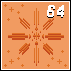
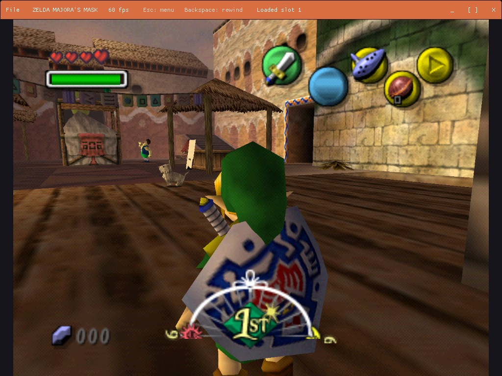
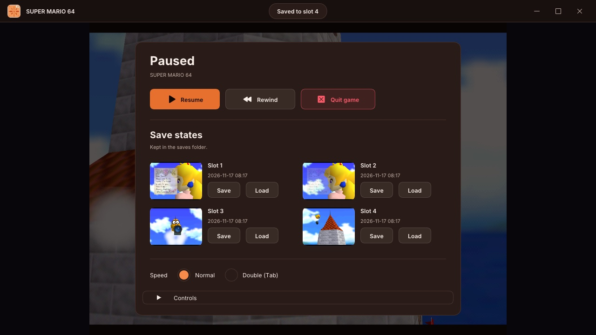
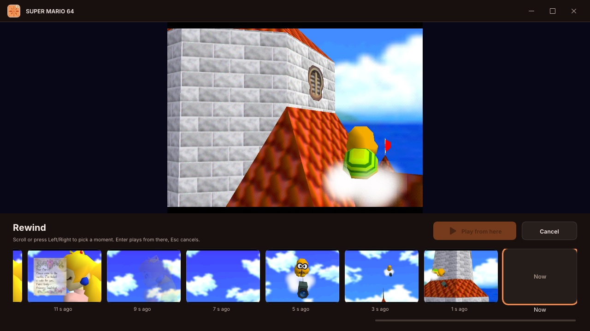
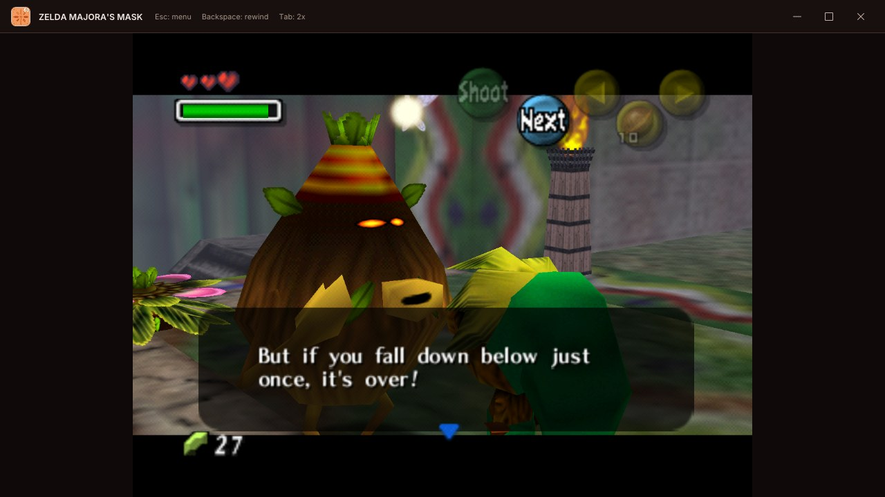
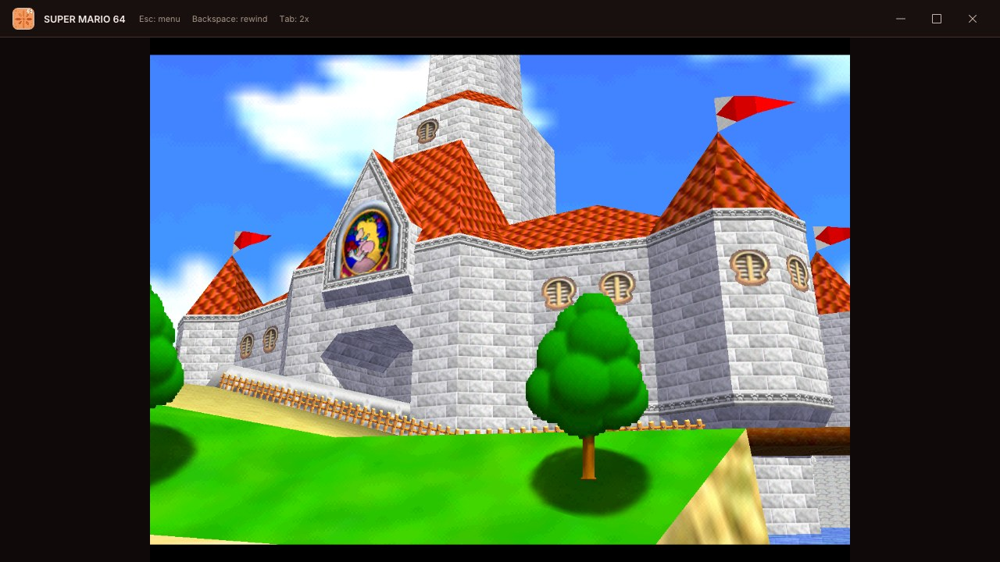
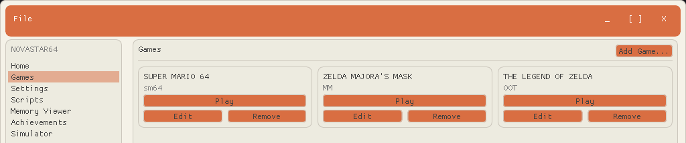
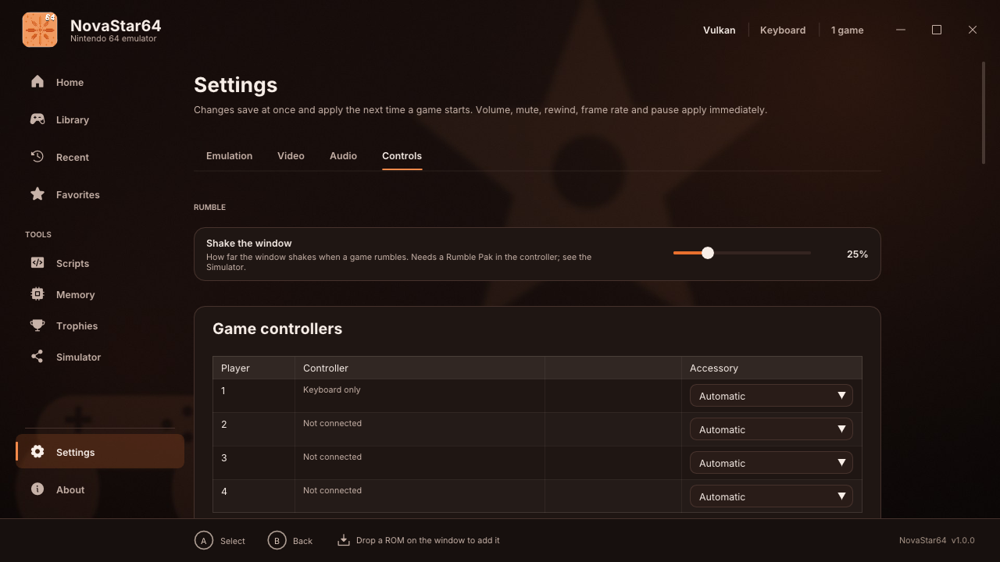
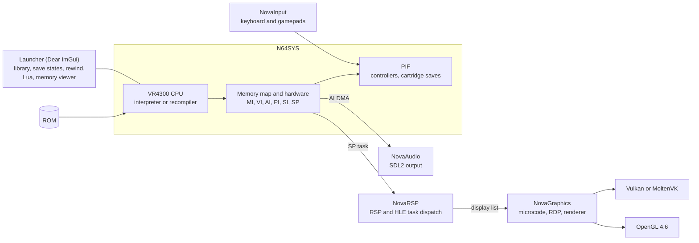

<p align="center">
  
</p>

<h1 align="center">NovaStar64</h1>

<p align="center">
  A Nintendo 64 emulator written in C++20, with a dynamic recompiler, a
  from-scratch high-level graphics pipeline, and save states with rewind.
</p>

<p align="center">
  
  
  
  
  
</p>

<p align="center">
  
</p>

NovaStar64 plays commercial N64 games inside a self-contained launcher window.
It has a game library, four save-state slots per game, and a rewind strip that
lets you jump back to any moment from earlier in your session. The CPU core and
the RSP began as a fork of [Project64](https://github.com/project64/project64)
and are credited as such; the graphics pipeline, launcher, controller support
and audio output were written from scratch.

The project is under active development. Expect bugs and rough edges — see
[Status](#status) for what has been tested and what is known to be wrong.

**Contents:**
[Highlights](#highlights) ·
[Screenshots](#screenshots) ·
[Status](#status) ·
[Getting started](#getting-started) ·
[Controls](#controls) ·
[Configuration](#configuration) ·
[How it works](#how-it-works) ·
[Development](#development) ·
[Known limitations](#known-limitations) ·
[Project64 and licensing](#project64-and-licensing) ·
[Third-party software](#third-party-software) ·
[Acknowledgements](#acknowledgements)

---

## Highlights

- **High-level graphics that models the RDP in generated shaders.** Colour
  combiner, blender, TMEM and every N64 texture format, TLUT, mipmapping, both
  hardware dither patterns, fog, chroma key, YUV conversion and N64-accurate
  decal depth comparison — produced as GLSL per render state rather than
  approximated with a fixed pipeline.
- **Vulkan and OpenGL backends.** macOS runs on Vulkan through the bundled
  MoltenVK (macOS caps OpenGL at 4.1; the GL path needs 4.6). Internal
  resolution scales from 1× to 8×.
- **Texture packs.** Loads Rice-format hi-res packs, so packs made for Glide64 and
  GLideN64 work as they are, and can write out a game's textures as a starting point
  for making one.
- **Save states and rewind.** Esc opens a pause menu with four save-state slots,
  each with a picture of where it was made. Backspace pauses and shows a strip
  of pictures — one for every 2 seconds of play — and you can resume from any
  of them. The history lives in memory and is discarded when the game closes.
- **A dynamic recompiler for x86-64 and ARM64**, alongside a MIPS interpreter.
  The two engines can be compared frame by frame with a state-trace tool (see
  [Development](#development)).
- **Deterministic emulation.** Two runs of the same build on the same ROM
  produce byte-identical state traces, which makes CPU and timing bugs
  reproducible and makes rewind verifiable.
- **Game controllers for up to four players** through SDL, with an
  N64-shaped analog range, rebindable buttons, per-controller player slots and
  a Rumble Pak. A controller also drives the launcher's menus.
- **Built-in tools:** a Lua scripting console, a memory viewer and a hardware
  simulator view.
- **Cartridge hardware:** EEPROM, SRAM and FlashRAM saves, Rumble Pak, Transfer
  Pak and partial N64DD support.
- **NTSC and PAL timing.** The video field rate, real-time frame pacing and the
  audio DAC clock are all derived from the ROM's region.
- **Experimental compute ray tracing** over the rasterised image (Settings →
  Video → *Ray-traced lighting*, or `NOVA64_RT=1`): soft shadows, ambient
  occlusion with one-bounce colour bleeding, reflections on water and metal, and
  point lights. Every object is shadowed toward the light the game lit it with,
  and accumulated history is kept only where a surface hasn't moved, so shadows
  settle when the picture is still and never lag when it isn't. Needs Vulkan and
  high-level graphics emulation. See
  [the ray tracer notes](nova64/NovaGraphics/Renderer/VK/VK_RayTracing_Architecture.md).

## Screenshots

<table>
  <tr>
    <td width="50%"></td>
    <td width="50%"></td>
  </tr>
  <tr>
    <td align="center"><b>Pause menu</b> — four save-state slots with pictures</td>
    <td align="center"><b>Rewind</b> — pick a moment from the last few seconds and play on from there</td>
  </tr>
  <tr>
    <td></td>
    <td></td>
  </tr>
  <tr>
    <td align="center"><b>Majora's Mask</b> — in-game text and UI</td>
    <td align="center"><b>Super Mario 64</b> — 4× internal resolution</td>
  </tr>
  <tr>
    <td></td>
    <td></td>
  </tr>
  <tr>
    <td align="center"><b>Game library</b></td>
    <td align="center"><b>Controller settings</b></td>
  </tr>
</table>

<sub>Game images are shown to illustrate the emulator. All game titles and
artwork belong to their respective owners; see [Legal](#legal).</sub>

## Status

Day-to-day testing uses three NTSC-U titles. Nothing else has been checked
systematically, and there is no automated compatibility suite.

| Game | Status | Notes |
|---|---|---|
| The Legend of Zelda: Majora's Mask (NTSC-U 1.0) | Playable | A 30-minute playthrough turned up only some incomplete visual effects. |
| Super Mario 64 (NTSC-U) | Playable | Title screen, the opening cutscene with Peach's letter, the castle grounds and the pause screen all work. |
| The Legend of Zelda: Ocarina of Time (NTSC-U 1.2) | Playable | Name entry, the intro dialogue, Link's house in Kokiri Forest and all four pause-menu pages (items, map, quest status, equipment) work. Opening the pause menu holds the last frame for a few seconds while the game filters it on the CPU. |

macOS on Apple Silicon is the only platform it has been built and run on. The
ARM64 recompiler runs the games above but is still incomplete — on Majora's Mask
its memory state drifts from the interpreter's early in boot (see
[CONTRIBUTING.md](CONTRIBUTING.md#what-still-differs-between-the-engines)) — so
the launcher's **Automatic** CPU core setting uses the interpreter on Apple
Silicon and the recompiler on x86-64.

## Getting started

NovaStar64 is an emulator only. It ships without games; you supply your own
legally obtained ROM images (`.z64`, `.n64`, `.v64`).

### Install

Each [release](https://github.com/V-B0/NovaStar64/releases) has an installer:

| Platform | File | What to do |
|---|---|---|
| macOS (Apple Silicon, macOS 13.3 or later) | `NovaStar64-<version>-macOS.dmg` | Open it and drag NovaStar64 onto Applications. |
| Windows (64-bit) | `NovaStar64-<version>-Windows-Setup.exe` | Run it and follow the setup wizard. `NovaStar64-<version>-Windows-portable.zip` runs from any folder, with nothing installed. |

macOS asks you to approve the app the first time you open it, because it is not
signed with a paid Apple developer certificate: try to open it, close the message,
then open System Settings → Privacy & Security and click **Open Anyway**. (On macOS
14 or earlier, right-click → Open does the same.) You only do this once. Intel Macs
build from source for now.

An installed copy keeps its settings, games and saves in your user data folder —
`~/Library/Application Support/NovaStar64` on macOS, `%LOCALAPPDATA%\NovaStar64` on
Windows — so updating or uninstalling the program never touches them. **Settings →
Emulation → Open data folder** shows where it is; see
[Configuration](#configuration).

### Build from source

**macOS and Linux:** one command from the top of the source tree.

```bash
git clone --recurse-submodules https://github.com/V-B0/NovaStar64.git
cd NovaStar64
./build.sh               # build; the program is nova64/build/nova64
./build.sh --run         # build, then open the launcher
./build.sh --package     # build an installer to give to other people (macOS: dist/*.dmg)
```

`build.sh` checks for a C++ compiler, CMake and Ninja and offers to install what is
missing (CMake and Ninja through Homebrew or pip, and on a Mac the Xcode command line
tools), downloads the libraries the first time, builds with a progress readout, and
says where the result is. The first build takes a few minutes; after that only what
you changed is rebuilt. `./build.sh --help` lists the options.

**Windows:** `build.bat` does the same with CMake and Visual Studio's C++ tools (it
tells you how to install them if they are missing). It has not been tried on a real
Windows machine yet.

<details>
<summary>The same thing by hand</summary>

You need CMake 3.28 or newer (built and tested with 4.3), a C++20 compiler (Apple Clang on macOS) and,
optionally, [Ninja](https://ninja-build.org/), which makes the build faster.

```bash
cmake -S nova64 -B nova64/build -G Ninja
cmake --build nova64/build
```

- The first configure needs an internet connection. Most dependencies (SDL2,
  Vulkan-Headers, volk, glslang, Dear ImGui, stb, nlohmann/json, rcheevos, AsmJit,
  Lua) are fetched by CMake's `FetchContent`, each pinned to an exact tag or commit —
  see [CONTRIBUTING.md](CONTRIBUTING.md) before changing one.
- Berkeley SoftFloat is a git submodule (`git submodule update --init`). If it is
  missing, for instance because you downloaded a source archive, the configure step
  fetches the same commit itself.
- macOS uses the prebuilt MoltenVK in `nova64/thirdparty/MoltenVK/`, which the build
  copies next to the executable. The build also signs the binary (ad hoc; an unsigned
  one can't load its dynamic libraries and hangs without an error message) and gives
  it the NovaStar icon in Finder. Signing refuses a file that already has the icon, so
  if you ever re-sign manually, do it on a fresh link.
- `pip install cmake ninja` puts the tools somewhere that is not on `PATH`
  (`~/Library/Python/3.9/bin` on macOS). If a hand-written build script seems to
  succeed while silently skipping the configure step, that is why; `build.sh` looks
  there itself.

</details>

### Run

```bash
nova64/build/nova64                    # open the launcher
nova64/build/nova64 path/to/game.z64   # start a game directly
```

An installed copy starts like any other application. Add your games with **Add Game**
in the launcher.

Games started from the launcher play inside its window. Esc opens the pause
menu, Backspace rewinds and Tab toggles double speed. On a controller, Back
(View, Select or Share) or Guide opens the pause menu.

<details>
<summary>Command-line options</summary>

```
--help, -h       Show this help message
--debug          Enable debug logging
--log <file>     Write log to file
--config <file>  Use specified config file
--frames <N>     Run for N frames (0 = unlimited, default)
--fps <N>        Speed as an NTSC frame rate: 60 = full speed (PAL games
                 pace at 50), 120 = double, 0 = unlimited; default 60
--resolution <R> Window resolution: 480p, 720p, 960p, 1080p, 1440p, 4k
--scale <N>      Internal resolution scale, 1-8x (overrides NovaGraphics.ini)
--fullscreen     Exclusive fullscreen
--windowed       Windowed mode
--interpreter    Force the interpreter (slower, better for debugging)
--recompiler     Force the dynamic recompiler (JIT)
--headless       Run without showing a window
--pipe <name>    Connect to a named pipe for IPC commands/framebuffer
```

</details>

## Controls

Every binding can be changed under **Settings → Controls**. Player 1 can use
the keyboard as well as a controller; players 2–4 use controllers.

| N64 | Keyboard (default) | Controller (default) |
|---|---|---|
| Analog stick | W A S D | Left stick |
| A | X | A |
| B | Z or Y | X or B |
| Z trigger | C | Left trigger |
| Start | Enter | Start |
| D-pad | T F G H | D-pad |
| L | Left Shift | Left bumper |
| R | Right Shift | Right bumper or right trigger |
| C buttons | Arrow keys | Right stick |

| Emulator | Keyboard | Controller |
|---|---|---|
| Pause menu (save states) | Esc | Back / Guide |
| Rewind | Backspace | Pause menu → Rewind |
| Double speed | Tab | Pause menu → Speed |

Controllers are assigned to players in the order the operating system reports
them, which can put a stale Bluetooth pairing ahead of the pad you are holding.
Settings → Controls has a "move to player" control per controller; the choice is
remembered for that specific controller.

## Configuration

Everything NovaStar64 keeps — `settings/`, `roms/`, `saves/`, `covers/`,
`hires_texture/` and the shader cache — lives in one data folder, chosen the same way
however the program is started, so the same games, save states, cartridge saves and
settings show up whether you open it from a terminal in any directory or from Finder.
In order:

1. `$NOVA64_HOME`, if that environment variable is set. Use it to keep several sets of
   saves, or to give a test run its own.
2. The folder containing the executable, for a *portable* copy: one with a
   `portable.txt` beside it (a build from source has one, and so does the Windows
   portable zip), or one that already holds `settings/`, `roms/` or `saves/`.
3. Otherwise your user data folder: `~/Library/Application Support/NovaStar64` on
   macOS, `%LOCALAPPDATA%\NovaStar64` on Windows, `$XDG_DATA_HOME/NovaStar64` (or
   `~/.local/share/NovaStar64`) on Linux. This is what an installed copy uses. To make
   a copy portable, put a `portable.txt` beside the executable.

Paths typed on the command line are relative to where you typed them, and
`nova64 roms/game.z64` falls back to the data folder's `roms/` when nothing is
there.

| File | Contents |
|---|---|
| `settings/NovaGraphics.ini` | Graphics driver, internal resolution, aspect ratio, ray tracing |
| `settings/launcher.ini` | Speed, display mode, CPU core, rewind, volume |
| `settings/keybindings.ini` | Keyboard bindings |
| `settings/controllers.ini` | Controller bindings, stick deadzone and range, Rumble Pak per player, preferred player slots |
| `settings/library.txt` | The game list |

Games added in the launcher are copied into `roms/`. Cartridge saves and save
states go in `saves/`. A cover picture chosen in the Add Game or Edit dialog (PNG or
JPEG) is copied into `covers/` and shown on the game's card. These folders are
git-ignored: their contents are never committed.

### Texture packs

NovaStar64 loads texture packs in the Rice Video format, the one Glide64 and GLideN64
use, so packs made for those work unchanged. Put a pack in
`hires_texture/<game name>/`, where the name is the game's internal name (for Super
Mario 64, `SUPER MARIO 64`; subfolders are fine) and leave **Settings → Video → Texture
packs** on. Each picture is named after the texture it replaces
(`SUPER MARIO 64#8A848688#3#1_all.png`) and is used in its place, at whatever
resolution it has; `_rgb` plus `_a` pairs and `$` wildcards are understood too.

To make a pack, turn on **Save game textures for making a pack** (or set
`NOVA64_DUMP_TEXTURES=1`), play, and collect the pictures from
`texture_dump/<game name>/`: each one is already named the way the pack expects. Paint
over them, keep the names, and put the results in `hires_texture/<game name>/`. Both
settings take effect when a game starts. Texture packs are not part of this project and
are not included.

Pictures must be PNG (the old `_ci.bmp` form is not read), and textures the game
mipmaps by hand, or whose checksummed area is not the whole texture, are not replaced.

## How it works



The CPU runs the game. When it starts an RSP task, NovaRSP hands graphics tasks
to `NovaGraphics` as display lists and processes audio tasks itself. The
graphics side decodes each command through a per-microcode handler, tracks RDP
state and TMEM, and emits batched draws whose fragment shaders are generated
from the current combiner, blender and texture state. The launcher hosts the
whole thing: the game renders offscreen and the launcher composites it, which
is what lets save states, rewind, the memory viewer and Lua reach the running
game on every platform.

| Path | Contents |
|---|---|
| `nova64/N64SYS/` | CPU core: MIPS interpreter, dynamic recompiler (x86-64 and ARM64), memory and hardware-register handlers, plugin interfaces, save types, machine snapshots for save states and rewind |
| `nova64/NovaRSP/` | RSP interpreter and recompiler, plus HLE audio and graphics task dispatch |
| `nova64/NovaGraphics/` | Microcode handlers, RDP processing, texture cache, Vulkan and OpenGL backends, ray tracer |
| `nova64/NovaAudio/` | Audio plugin: AI DMA bridge and SDL2 output |
| `nova64/NovaInput/` | Keyboard and game controller input, bindings |
| `nova64/NovaLua/` | Embedded Lua scripting engine |
| `nova64/UI/` | The launcher |
| `nova64/common/` | Shared utilities: logging, INI parsing, file I/O, platform macros |
| `nova64/scripts/` | Development tools: trace comparison, derivation measurement, icon generation |
| `nova64/assets/` | The NovaStar icon (PNG, and ICO for the Windows executable), built into the program |
| `nova64/cmake/` | The build definition: `Sources.cmake` (our source files) and `Dependencies.cmake` (the pinned third-party libraries); `nova64/CMakeLists.txt` ties them together |
| `nova64/installer/` | The Windows setup wizard (Inno Setup); `nova64/scripts/package-macos.sh` makes the macOS app and `.dmg` |
| `nova64/thirdparty/`, `nova64/external/` | Third-party files that ship in the repository: the MoltenVK library for macOS and the glad OpenGL loader |
| `softfloat/` | Berkeley SoftFloat, used for the FPU |
| `docs/` | Design notes and roadmaps |

## Development

Emulator bugs regress silently: the build stays green, the ROM still boots, and
one effect somewhere renders wrong. NovaStar64 therefore leans on tooling that
makes behaviour *comparable*:

- **State traces.** `NOVA64_TRACE_STATE=<file>` records a digest of CPU, FPU, CP0
  and (optionally) RDRAM state once per video frame. `nova64/scripts/compare-trace.py`
  diffs two traces and exits non-zero on divergence — comparing a build against
  itself, the interpreter against the recompiler, or a rewind against the frames
  it replays.
- **Unattended runs.** `--headless` runs a game with no window, and the
  `NOVA64_UI_*`, `NOVA64_SHOT_*` and `NOVA64_AUTOINPUT` variables script the
  launcher, capture screenshots and play a controller from a script — every
  screenshot in this README was taken that way.

[CONTRIBUTING.md](CONTRIBUTING.md) documents the workflow, the full list of
diagnostic variables and the failure modes that have already cost time.

## Known limitations

- No netplay, and no RetroAchievements support yet (the tab is a placeholder).
- Only NTSC-U games have been tested. PAL timing is implemented but has not
  been checked against a commercial PAL game.
- Majora's Mask has some incomplete visual effects (see [Status](#status)).
- Ocarina of Time's pause menu holds the last frame for a few seconds while the game
  builds its background on the CPU. The length of the wait has not been compared with
  real hardware.
- The launcher is written to build on Windows and Linux but has only been built
  and run on macOS. `build.sh` has only been run on macOS, and `build.bat`, the
  Windows installer and portable zip, and the release workflow that makes them have
  not been run on Windows yet; the first release build there may need fixes. Drawing a game inside the launcher with the OpenGL renderer
  (the default outside macOS) is untested; Vulkan is the tested path.
- Controller support has been exercised with a physical controller on macOS and
  with SDL's virtual controllers; rumble motor output has not been verified. The
  Controller Pak (memory card) is not available.
- The ray tracer is an experimental research feature. It runs on the GPU's
  compute units (MoltenVK has no hardware ray tracing), traces at half
  resolution, and costs roughly 2 to 4 ms a frame at 720p, growing with the
  window size. Point lights (torches, fires) are only seen in games that switch
  positional lighting on, and haven't been tried in a real game yet.
- Save states made before rewind was added can't be loaded.
- The audio plugin's buffer-level and sync calls are accepted but not applied to
  the output stream.
- On case-sensitive filesystems (Linux), cartridge saves are written to
  `Saves/` and save states to `saves/`.

## Project64 and licensing

Copyright (C) 2026 Varga Bálint. NovaStar64 is licensed under **GPL-2.0** (see
[LICENSE](LICENSE)). It began as a fork of Project64 and remains a derivative work
of it, so it carries Project64's license. Code derived from Project64, and through
it from mupen64plus-rsp-hle, stays copyright its original authors, as the notices in
those files say. The Project64-derived code is identified precisely rather than in
general terms:

| Subsystem | Files crediting Project64 | Lines in those files |
|---|---|---|
| `N64SYS/` | 51 of 127 (40%) | 31,306 of 62,909 (50%) |
| `NovaRSP/` | 58 of 66 (88%) | 21,779 of 23,465 (93%) |
| `NovaGraphics/` | 0 of 115 (0%) | 0 of 55,678 (0%) |
| `NovaAudio/` | 0 of 2 (0%) | 0 of 397 (0%) |
| `NovaInput/` | 0 of 6 (0%) | 0 of 1,136 (0%) |
| `NovaLua/` | 0 of 2 (0%) | 0 of 350 (0%) |
| `UI/` | 0 of 13 (0%) | 0 of 3,190 (0%) |
| `common/` | 1 of 24 (4%) | 468 of 5,954 (8%) |
| `main.cpp` | 0 of 1 (0%) | 0 of 346 (0%) |
| **Total** | **110 of 356 (31%)** | **53,553 of 153,425 (35%)** |

A file counts if its header credits Project64, and is counted in full, so these
figures are an upper bound on the derived code. Regenerate them with
`python3 nova64/scripts/measure-derivation.py --markdown`.

Files carrying Project64 code say so in their header. Those headers are
required by GPL-2.0 § 1 and must not be removed — removing one does not change
what the code is derived from, it only makes the project non-compliant.

GPL-2.0 permits commercial sale. What it requires is that recipients get the
source and the same rights; it does not permit shipping this closed-source. A
proprietary derivative would need the Project64-derived subsystems replaced by
genuine clean-room reimplementation — see
[docs/REIMPLEMENTATION.md](docs/REIMPLEMENTATION.md).

## Third-party software

Each component keeps its own license.

| Component | Used for | License |
|---|---|---|
| [AsmJit](https://github.com/asmjit/asmjit) | Recompiler code generation | Zlib |
| [SDL2](https://github.com/libsdl-org/SDL) | Windowing, input, audio | zlib |
| [Vulkan-Headers](https://github.com/KhronosGroup/Vulkan-Headers), [volk](https://github.com/zeux/volk) | Vulkan API and loader | Apache-2.0 / MIT; MIT |
| [glslang](https://github.com/KhronosGroup/glslang) | GLSL to SPIR-V for the Vulkan backend | BSD-3-Clause and others |
| [MoltenVK](https://github.com/KhronosGroup/MoltenVK) | Vulkan on Metal (prebuilt macOS library in `nova64/thirdparty/MoltenVK/`, with its license text) | Apache-2.0 |
| [glad](https://github.com/Dav1dde/glad) 2.0 | OpenGL loader (generated, `nova64/external/glad/`) | (WTFPL or CC0-1.0) and Apache-2.0; `khrplatform.h` is Khronos MIT-style |
| [Dear ImGui](https://github.com/ocornut/imgui), [imgui-node-editor](https://github.com/thedmd/imgui-node-editor) | Launcher UI | MIT |
| [stb](https://github.com/nothings/stb) | Image reading and writing | MIT / public domain |
| [nlohmann/json](https://github.com/nlohmann/json) | JSON | MIT |
| [rcheevos](https://github.com/RetroAchievements/rcheevos) | RetroAchievements (not yet wired up) | MIT |
| [Lua](https://www.lua.org/) 5.4 | Scripting | MIT |
| [Berkeley SoftFloat](http://www.jhauser.us/arithmetic/SoftFloat.html) 3e | FPU arithmetic (`softfloat/`) | BSD-3-Clause |

## Acknowledgements

- The [Project64](https://github.com/project64/project64) team, whose CPU
  core, recompiler and RSP this project started from.
- [mupen64plus-rsp-hle](https://github.com/mupen64plus/mupen64plus-rsp-hle), whose
  audio microcode behaviour the RSP HLE follows; source comments cite it
  throughout.
- [GLideN64](https://github.com/gonetz/GLideN64) and
  [angrylion-rdp-plus](https://github.com/ata4/angrylion-rdp-plus), used as
  behavioural references for graphics accuracy. Where a specific behaviour is
  modelled on one of them, the source comment says so.
- The N64 hardware documentation and homebrew community.

## Legal

Copyright (C) 2026 Varga Bálint. NovaStar64 is not affiliated with or endorsed by
Nintendo or the Project64 team. Nintendo 64 and the names of the games shown are trademarks of their
respective owners. NovaStar64 contains no game images or console firmware; use
it only with games you own.

## Contributing

Contributions are welcome — see [CONTRIBUTING.md](CONTRIBUTING.md). For anything
large, open an issue first so the direction can be agreed.

## License

GPL-2.0. See [LICENSE](LICENSE).
